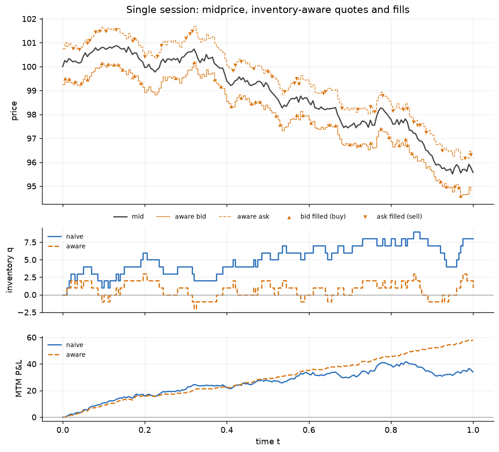
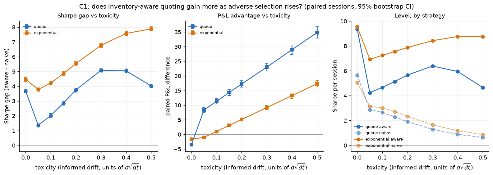
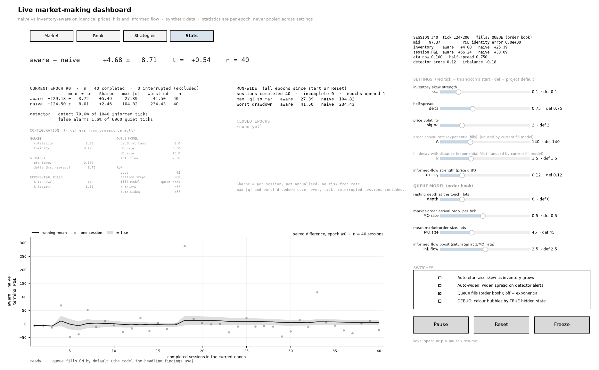
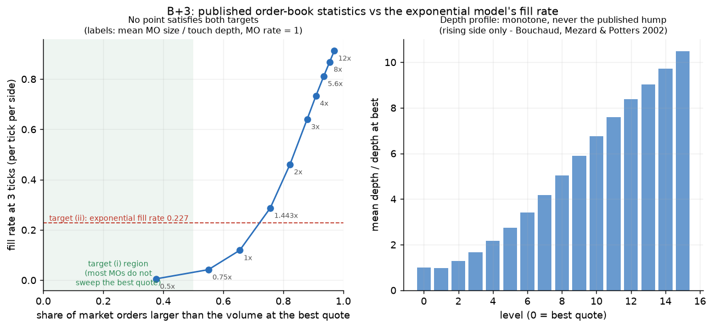
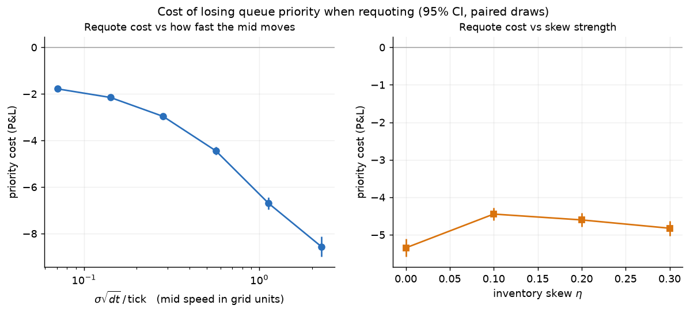
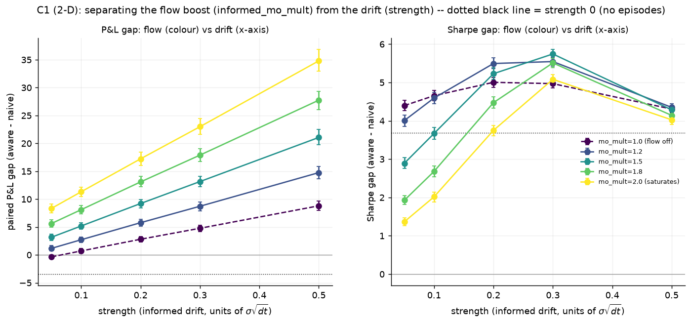
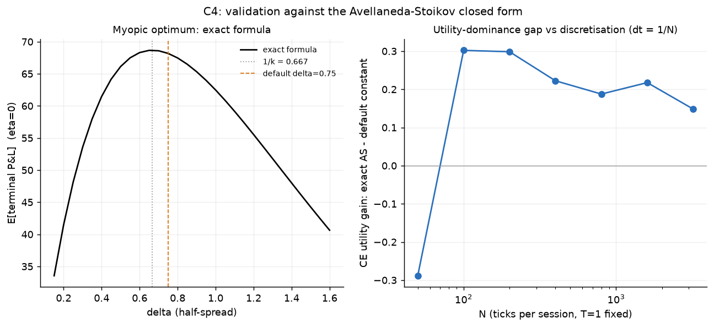
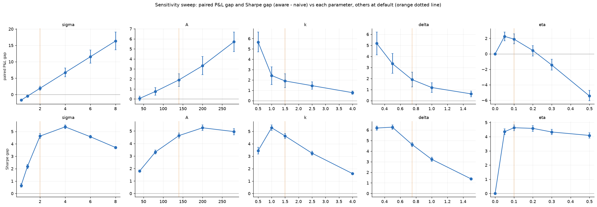
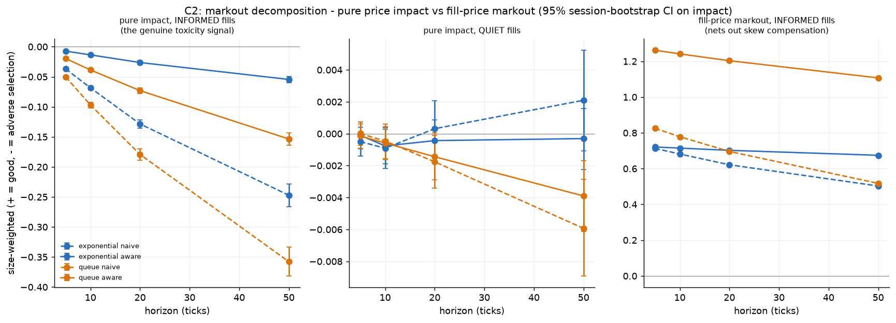

# mmsim: inventory-aware market making on synthetic data

## At a glance

A market-making simulator that runs two quoting strategies side by side on *identical*
synthetic prices, fills and informed order flow: a **naive** maker that quotes
symmetrically around the mid, and an **inventory-aware** one that skews its quotes against
the position it is holding (Avellaneda-Stoikov style). Fills come from either the textbook
exponential intensity model or a limit order book with queue position and partial fills,
and a live dashboard lets you watch both strategies trade tick by tick.

**Key results** (details and caveats in [Findings](#findings) and [Limitations](#limitations---read-before-quoting-any-number)):
- Skewing has the higher Sharpe ratio at every point tested, including with no adverse
  selection at all, where certainty-equivalent utility agrees.
- On raw mean P&L, skewing *loses* at zero toxicity and wins once informed flow is
  present; its advantage reaches **+34.80 per session** at the highest modelled toxicity
  (queue model). The two statistics disagree, and that disagreement is itself a finding.
- The textbook fill-rate model and a realistically deep order book cannot both be
  satisfied: matching the exponential fill rate needs ~76% of market orders to sweep past
  the best quote.
- Correctness checks run throughout: the P&L identity `Pi = spread_pnl + inventory_pnl`
  holds to 1e-9 or better, the live and batch engines agree session by session, and the
  suite has 192 tests.



*One session. The naive maker (blue) drifts to a large long position as the price falls;
the aware maker (orange) skews its quotes to keep inventory near zero and ends ahead.*



*Aware minus naive as adverse selection rises (paired sessions, 95% bootstrap CIs). The
Sharpe gap (left) stays positive throughout; the mean P&L gap (middle) starts negative and
then grows steadily.*



*The live dashboard (Stats tab) after 40 sessions at default settings, seed 42. Over this
short run the mean P&L gap (+4.68 ± 8.71) is still noise, while the risk statistics
already separate clearly: Sharpe 5.49 vs 2.46, max |inventory| 27 vs 105.*

**Where to look in the code:**
- `src/mmsim/core.py`: the one-tick step function; all accounting lives here, shared by
  both fill models and by the live and batch engines.
- `src/mmsim/book.py` and `fills.py`: the limit order book with queue position, and the
  exponential fill model.
- `src/mmsim/strategies.py`: the naive / inventory-aware quoter and the exact
  Avellaneda-Stoikov policy.
- `src/mmsim/adverse.py`: hidden informed episodes, the model of adverse selection.
- `scripts/live_dashboard.py`: the interactive dashboard (simulation in `live_sim.py`).
- `tests/test_equivalence.py`: proves the live and batch engines agree exactly.

To run it yourself, see [How to reproduce](#how-to-reproduce).

## Research question

Does an inventory-aware market maker (quotes skewed against its inventory, `eta > 0`)
beat a naive symmetric one (`eta = 0`), and how does that depend on adverse selection?
Everything runs on synthetic data, seeded and deterministic - nothing here is fit to or
validated against a real market.

**One-paragraph answer, conditional, not flat:** skewing wins on risk-adjusted terms
(Sharpe or certainty-equivalent utility) *everywhere tested*, including with zero adverse
selection at all - that is Avellaneda-Stoikov's own risk-aversion rationale, confirmed
here from the mechanism rather than assumed. On raw mean P&L, skewing *loses* at zero
toxicity (it gives up spread capture to protect against a risk nothing is threatening)
and only wins once there is real toxicity to defend against, after which its advantage
grows monotonically and becomes large - up to +34.80 per session at the highest modelled
toxicity under the queue fill model. Which of these is "the" answer depends on which
statistic you read and which fill model you use; this project reports both, always,
because reporting only one inverted the conclusion three separate times (Finding 8).

## The P&L identity: the spine of everything below

For any quoting strategy, any fill model, any fractional or partial fill size:

    Pi_{n+1} - Pi_n  =  F_bid*(m_n - bid) + F_ask*(ask - m_n)  +  q_{n+1}*(m_{n+1} - m_n)
                        \_________________ spread capture _________________/   \_ inventory P&L _/

Summed over a session: `Pi_N = spread_pnl + inventory_pnl`, exactly - verified to 1e-9
(exponential model) and 1e-12 (queue model, including sessions where 2.9% of fills are
partial) in every configuration tested. It needs no assumption that sizes are 1 or that
quotes sit exactly `delta` from the mid; it holds for whatever price and size a fill
actually executes at.

**What this implies about any strategy.** Neither naive nor aware can change the midprice
process itself - both see the same `m_n` path (common random numbers throughout this
project: every paired comparison runs on *identical* prices, fill draws and informed
episodes). A strategy's only lever is WHERE it quotes, which determines two things: how
much `spread_pnl` it captures per fill, and how much inventory risk it is left holding
between fills (`inventory_pnl`'s variance). Every result in this project is ultimately a
statement about how a strategy trades off those two terms - skewing (`eta > 0`) always
costs some spread capture (quotes move away from the mid on the side it wants to avoid)
in exchange for lower inventory variance. Whether that trade is worth it is the entire
research question.

## The model

- **Midprice**: `m_{n+1} = m_n + sigma*sqrt(dt)*Z_n` (arithmetic random walk, zero drift
  at baseline). Optionally, hidden "informed episodes" add a drift term and bias fill
  arrivals - this project's synthetic stand-in for adverse selection (see Limitations).
- **Two fill models**, selected by a flag, sharing one `core.step` so quoting and
  accounting are identical either way:
  1. **Exponential** (the textbook Avellaneda-Stoikov intensity): `p = min(1, A*exp(-k*d)*dt)`
     per side per tick, an independent Bernoulli draw. Fills are indicators (0 or 1).
  2. **Queue** (a limit order book): quotes round to a price grid (tick size 0.25) and
     join the back of that level's queue; market-order flow consumes the queue from the
     front; a fill occurs only once everything ahead of the order is consumed, and may be
     **partial**. Moving a quote's price cancels it and rejoins at the back - the cost of
     requoting is a first-class, measured quantity (Finding 2).
- **Two strategies**: naive (`InventorySkewQuoter(delta, eta=0)`, symmetric) and aware
  (`InventorySkewQuoter(delta, eta>0)`, reservation-price skew `r = m - eta*q`). A third,
  `AvellanedaStoikovQuoter`, implements the *exact* time-varying AS policy
  (`eta_t = gamma*sigma^2*(T-t)`) and is used only in the closed-form validation (Finding 5).
- **What's synthetic vs. calibrated**: EVERYTHING - the midprice, the informed-episode
  model, the order book's depth and market-order parameters - is synthetic; none of it is
  fit to real market data. "Calibrated" is used in this project only in the narrow sense
  of back-solving a number against the model's OWN other choices or against a theoretical
  identity (e.g. the informed-drift strength against the model's own net-move variance;
  `gamma` against the project's own default `eta`). The queue book's depth/market-order
  defaults are **tuned to fill rate, not calibrated to real books** - a deliberate choice,
  because the two cannot both be had (Finding 1).

## Findings

### 1. A realistic book and the Avellaneda-Stoikov fill rate are incompatible - two independent routes to the same conclusion
At the defaults (`A=140, k=1.5, dt=0.005`), a quote `delta=0.75` from the mid trades with
probability `p = 140*exp(-1.5*0.75)*0.005 = 0.227` - 22.7% of ticks, per side. At a 0.25
tick that quote sits 3 price levels out, so in an actual book it fills only once a market
order consumes everything in front of it. **Two separate investigations, one accidental
and one deliberate, land on the same incompatibility.**

**Route A - a build accident.** The first-pass book (20 lots at the touch, growing
0.35/level, market orders averaging 12 lots) put the threshold at `20+27+34+41=122` lots,
giving `P(Exp(12)>122) = exp(-122/12) = 3.8e-5` - about **6,000x** below 0.227. It produced
*exactly zero fills over 400 sessions*. The models reconcile on mean rate only by making
the book thin relative to market-order size (the shipped defaults - 8 lots at the touch,
45-lot market orders - give ~0.36 fills/tick/side).

**Route B - deliberate calibration against published statistics** (`scripts/calibrate_book.py`,
n=400, seed 2024; figure: `figures/book_calibration.png`). Two targets were held separate
and never allowed to collapse into one another: (i) published order-book regularities -
most market orders do not exhaust the depth at the best quote (Hollifield, Miller & Sandas
2004, Stockholm Stock Exchange: average best-quote depth about **9x** average market-order
size, with almost no orders exceeding available depth), cancellation dominates execution
(Hasbrouck & Saar 2002: 93% of INET limit
orders cancelled), order sizes are heavy-tailed with exponent ~1.5 (Gopikrishnan et al.
2000), the mean depth profile is hump-shaped (Bouchaud, Mezard & Potters 2002); and (ii) the
exponential model's own fill rate, 0.227. The thresholds used to test (i) are this project's
own operationalisations, not literature values, and one of them has a unit mismatch with its
source - both flagged in Limitations. Sweeping mean market-order size against touch depth at
market-order rate 1:

| MO size / touch depth | P(MO > touch depth) | fill rate at 3 ticks | satisfies |
|---|---|---|---|
| 0.5 | 37.6% | 0.0054 | (i) sweep criterion only |
| 0.75 | 55.1% | 0.0421 | neither |
| 1.0 | 65.5% | 0.119 | neither |
| 1.44 | 75.7% | 0.287 | (ii) |
| >= 2 | >= 82% | above target | (ii) |



**No setting satisfies both.** The only (i)-satisfying point fills ~42x below target;
reaching 0.227 requires ~76% of market orders to sweep past the best quote. Heavy tails do
not rescue it: with a Pareto size tail (alpha=1.5, median MO = touch depth), the analytic
level-3 fill probability is 0.046 (back of queue) to 0.096 (front, flat profile) - still
below 0.227 by 2.4-4.9x. Two further mismatches are structural, not a matter of tuning:
cancellation volume never reaches 10x market-order volume in any configuration tried (1.19
at the shipped defaults), and the mean depth profile rises monotonically away from the
touch (level 1 = 0.98x the touch, level 15 = 10.5x) - the rising side of the published
hump, never its decay.

**The conclusion is the incompatibility itself, not a limitation of this book.** The AS
intensity is not a neutral convenience: at a 3-tick quoting distance it implies a market
where a single market order routinely sweeps several levels, and that is not an artefact of
one parameter guess - it survives a full sweep of market-order size and an analytic
heavy-tail bound. This project therefore keeps the queue defaults **tuned to fill rate, not
calibrated to real books**, deliberately: recalibrating to realistic depth would re-run
every result in a regime where almost nothing fills, and the book still would not be
realistic, because the cancellation ratio and the depth profile would remain wrong. The
gap is measured above rather than apologised for.

**The finding survives the strictest plausible reading of the empirical thresholds.** Target
(i) is a tendency across venues, not a law, and the most permissive real-market figure found
in the citation check - an eBay study in which nearly two-thirds (67%) of market orders
completely empty the best offer - still sits *below* the ~76% sweep rate this model needs to
reach the exponential fill rate, and far below the 90.8% at the shipped defaults. Loosening
the threshold from `P(MO > touch) < 0.5` all the way to that eBay figure therefore does not
close the gap; neither does the heavy-tail bound, which caps the fill probability at 0.096
against a target of 0.227 regardless of where the sweep threshold is drawn. The conclusion
does not depend on the exact threshold chosen.

### 2. Queue priority: earned when the mid is slow, costly to lose when it's fast - opposite directions, same ratio
Measured with a paired counterfactual (`QueueConfig.keep_priority`, which lets an order
keep its queue place through a price change - something no real venue allows) run against
the realistic setting on identical draws:

| sigma*sqrt(dt)/tick | ticks per requote | priority cost | as % of P&L |
|---|---|---|---|
| 0.071 | 8.65 | -1.79 | -1.2% |
| 0.566 | 3.40 | -4.45 | -3.3% |
| 2.263 | 1.68 | -8.56 | -9.5% |



A quote survives 8.65 ticks at the slow end against 1.68 at the fast end, so queue
position can only be BUILT when the mid is slow relative to the tick. But the P&L lost to
losing it moves the opposite way: with a fast mid you are permanently at the back of the
queue, so the free-requoting counterfactual is worth far more there. Cost = (how often you
requote) x (value of a queue place), and the first factor dominates. The cost is also
**flat in the inventory skew eta, and largest for the naive strategy** - naive already
requotes on 27% of ticks from mid-wander alone (cost -5.35), aware's skew adds only ~2
percentage points more (cost -4.45 at eta=0.1); the differential is **+0.90 +- 0.15 in the
aware strategy's favour** - skewing is very slightly *cheaper* in priority terms, the
opposite of both pre-registered predictions for this result.

### 3. Queue fills are 4x more "picked off"; the exponential model cannot structurally represent why
At a matched mean fill rate (eta=0.1, default toxicity, both tuned to the same order of
magnitude), the two models' fills still differ sharply in composition:

| model | fills/tick/side | partial | burstiness | picked off | rate given informed | rate given quiet |
|---|---|---|---|---|---|---|
| exponential | 0.253 | 0.0% | 0.020 | 0.063 | 0.370 | 0.235 |
| queue | 0.365 | 2.9% | 0.110 | 0.263 | 0.530 | 0.338 |

(`picked off` = `E[signed fill x informed direction]`; `burstiness` = lag-1
autocorrelation of "traded this tick".) Informed flow arrives in the queue model as
*larger, one-sided market orders that reach deeper into the book* - both filling the
maker more often AND in bigger size on the wrong side. The exponential model's
`fill_boost` can only raise a probability; it cannot make a fill bigger or deeper, so its
adverse selection structurally saturates below what the queue model can represent.
**Matching the mean fill rate is the floor, not the result - the two models agree on
"how often" and disagree sharply on "how bad."**

### 4. C1's pre-registered prediction: mechanism confirmed, statistic wrong
Adverse selection has two independent knobs in the queue model - drift (`strength`) and
one-sided flow intensity (`informed_mo_mult`) - swept on a 2-D grid, 10,000 paired
sessions per point:

| paired P&L gap | strength 0.05 | 0.10 | 0.20 | 0.30 | 0.50 |
|---|---|---|---|---|---|
| flow OFF (drift only) | -0.35 | 0.71 | 2.81 | 4.77 | 8.80 |
| flow at its max modelled strength | 8.34 | 11.32 | 17.23 | 23.00 | 34.80 |



**The P&L gap rises monotonically everywhere** - the main hypothesis (more toxicity, more
valuable skewing) holds cleanly. The PRE-REGISTERED prediction was narrower and specific
to Sharpe: that the queue model's Sharpe gap would rise more steeply than the exponential
model's, since queue-model toxicity is structurally worse (Finding 3). **Scored: NOT
CONFIRMED on that statistic.** Every row with flow present RISES then FALLS in Sharpe gap
(peaking around strength 0.2-0.3); the flow-off row stays nearly flat. The turnover traces
to flow specifically, not drift - the queue model's bigger, burstier fills inflate the
*variance* of both strategies' outcomes as flow strength rises, and the Sharpe
denominator eventually grows faster than the numerator. **The mechanism (queue adverse
selection is worse, skewing against it is more valuable) is confirmed on P&L; the specific
statistic it predicted (a steeper Sharpe slope) is not - separating those two is more
informative than a clean confirmation would have been.**

At zero toxicity (no episodes at all): P&L gap -3.45 [-3.75, -3.15] (queue), -1.64
[-1.87, -1.41] (exponential) - see Finding 5 for why this needs Sharpe/utility, not just
P&L, to read correctly.

### 5. Closed-form validation against Avellaneda-Stoikov (2008)
In the regime AS describes (exponential fills, zero toxicity, no frictions), two
quantities have closed forms derivable independently of the paper, verified bit-for-bit
against the simulator's own mechanics:
- **Myopic optimal half-spread `delta* = 1/k`** (argmax of single-tick expected revenue
  `A*dt*d*exp(-k*d)`, pure calculus, independent of AS). The simulated P&L-maximising
  delta lands on `1/1.5 = 0.6667` to four decimal places; the exact formula
  `N*2*p(delta)*delta` matches the simulated mean at every grid point to within bootstrap
  noise (well under 1%). The project's default `delta=0.75` sits 12.5% above this
  risk-neutral optimum - a design choice that predates this validation.
- **The eta=0 terminal inventory variance `Var(q_N) = N*2p(1-p)`** (exact at every dt,
  since fills are iid Bernoulli when eta=0 - no continuum limit needed). The
  simulated/exact ratio stays at 0.987-1.015 across a 16x range of dt (N=50 to N=800)
  with no trend.



**`gamma` (risk aversion) does not exist anywhere else in this project**, so it was
back-solved, a stated convention and not a literature value: requiring the AS
time-varying `eta_t`, averaged over a session, to equal the project's existing default
constant `eta=0.10` gives **gamma = 0.05**. Every certainty-equivalent utility number
anywhere in this README depends on that choice.

**Headline result - an apparent utility-dominance violation, investigated, not hidden.**
A grid search over constant `(delta, eta)` for CE utility at gamma=0.05 found a point,
`(0.7, 0.05)`, that BEATS the exact time-varying AS policy (CE 66.448 vs 65.772) - which
should not happen if the exact policy is truly optimal. Checked rather than asserted
either way:
- **Not sampling noise or grid-search overfitting**: the gap is STABLE from n=10,000 to
  n=60,000 (-0.676, -0.704, -0.720); noise or an overfit argmax would shrink toward zero.
- **Not the quote-distance floor**: negligible clamping (<0.01% of ticks) for all policies.
- **Not resolved by finer discretisation**: pushed to N=3200 ticks/session (a 64x range of
  dt); the gain oscillates (-0.289, +0.302, +0.298, +0.222, +0.188, +0.218, +0.148) without
  settling. Each N here redraws an entirely independent sample, so this reads as Monte
  Carlo noise comparable in size to the dt-trend being sought at n=10,000 - more SESSIONS,
  not more ticks, would resolve it; left open rather than guessed at.
- **Most likely explanation**: the widely-cited AS closed form is itself a known
  APPROXIMATION to the full HJB solution, not the literal optimal control (Gueant, Lehalle
  & Fernandez-Tapia 2012 derive the exact solution and show the closed form approximates
  it). A small, stable shortfall is CONSISTENT WITH that property of the formula - this is
  not claimed to DEMONSTRATE it, since this simulator's own discrete-time mechanics are a
  further, separate approximation that has not been disentangled from AS's own.

**The zero-toxicity result, corrected using gamma=0.05 (back-solved, as above).** At
matched n=10,000, exponential model: mean P&L gap **-1.643** (naive wins), Sharpe gap
**+4.475** (aware wins), CE utility gap **+2.222** at gamma=0.05 (aware wins). AS's theory
optimises utility, not mean P&L - this is the comparison that actually validates the AS
mechanism, and it holds.

### 6. The sensitivity sweep confirms Finding 5's pattern on an independent axis
Sweeping sigma, A, k, delta and eta one at a time (exponential model, default toxicity,
5,000 paired sessions per point): **the Sharpe gap is positive across the ENTIRE grid for
all five parameters** - never once crosses zero, from sigma 0.5 to 8, A 40 to 280, k 0.5
to 4, delta 0.3 to 1.5, eta 0.05 to 0.5. The paired mean-P&L gap flips sign on two:
- **sigma**: negative below sigma~1 (-1.70 at 0.5, -0.50 at 1.0), positive from sigma=2 up
  (+16.32 at sigma=8) - the SAME mean-P&L-vs-Sharpe divergence as Finding 5, found
  independently by varying volatility instead of toxicity.
- **eta**: positive and peaking near eta=0.05-0.10 (+2.26, +1.90 - close to the project's
  own default), crossing negative by eta=0.3 (-1.44) and sharply negative by eta=0.5
  (-5.44), while Sharpe stays solidly positive throughout (4.09-4.63): over-skewing gives
  up more spread capture than it saves, even though it keeps reducing variance.

A, k and delta show no sign change over the ranges tested. (Caveat: the fill-probability
cap binds on up to 6.82% of quote-sides at the sigma/A extremes - trust the direction of
those points more than their exact magnitude.)



### 7. Skewing protects two ways: pricing the risk, and selecting against it (C2)
Markout decomposes exactly: `markout_h = distance_captured + impact_h`. `distance_captured`
(h-independent) is the static compensation charged at fill time - constant for naive, but
WIDENS on whichever side is under pressure for aware. `impact_h` is the PURE subsequent
price move, excluding any pricing choice - the genuine toxicity signal, a property of the
flow, not the strategy. At h=20 ticks, default toxicity:

| model | strategy | distance captured (informed) | pure impact (informed) | fill-price markout (informed) |
|---|---|---|---|---|
| exponential | naive | 0.7500 | -0.1285 | +0.6215 |
| exponential | aware | 0.7284 | -0.0263 | +0.7021 |
| queue | naive | 0.8752 | -0.1793 | +0.6959 |
| queue | aware | 1.2764 | -0.0731 | +1.2033 |

**Pure impact is negative on informed fills for every combination** - the flow really is
adverse, independent of pricing - and more negative under the queue model at matched
strategy, confirming Finding 3 fill-by-fill via a metric a real desk would compute.



The first run of this analysis looked like a bug: aware's fill-price markout on informed
fills came out POSITIVE and even exceeded its own quiet-fill markout. Checked for
stability (stable n=500 to n=8000) and decomposed rather than patched, and the
decomposition revealed **two distinct, both-measured mechanisms, neither predicted in
advance**:
1. **Pricing**: aware's `distance_captured` widens sharply on the threatened side (skew
   compensation), and at this toxicity level OVER-compensates for the impact - the
   fill-price markout nets positive. This is the mechanism working, not an absence of
   adverse selection.
2. **Selection**: aware's PURE IMPACT is *also* smaller in magnitude than naive's at every
   horizon and on both models (exponential: -0.0263 vs -0.1285 at h=20; queue: -0.0731 vs
   -0.1793) - not merely priced better, genuinely LESS TOXIC on the fills that occur. As
   inventory builds during an episode, the widening quote moves away from danger, so the
   fills that still land there are increasingly drawn from the early, less-severe part of
   the episode - the worst exposures are avoided, not just compensated for.

**The same move as Finding 4**: an apparent anomaly, resolved by decomposing into two
mechanisms rather than patched or dismissed. This is now a recurring, transferable pattern
in how this project handles a surprising number (see Finding 8 and Methodology).

### 8. Mean P&L and Sharpe/utility disagree - and that disagreement is itself the finding
This happened three times, independently, on three different axes:
1. **Finding 4** (toxicity sweep): the Sharpe gap and P&L gap ranked the two fill models
   OPPOSITELY as toxicity rose.
2. **Finding 5** (zero-toxicity point): mean P&L favours naive; Sharpe and CE utility both
   favour aware, at the SAME point.
3. **Finding 6** (sensitivity sweep, sigma axis): mean P&L gap negative at low sigma,
   positive at high sigma; Sharpe gap positive throughout.

**Why**: in this model the inventory-aware strategy's advantage is substantially a
VARIANCE advantage, not purely a mean advantage. Sharpe and CE utility reward variance
reduction directly; mean P&L is blind to it. Any single-statistic comparison can therefore
invert its own conclusion depending on which statistic was chosen. The sigma axis
reproducing the same divergence that first appeared on a completely different sweep
(toxicity) is the evidence this is structural, not an artifact of one sweep's setup.
**Adopted practical rule: report mean P&L AND a variance-aware statistic together for
every paired comparison in this project, never one alone, and state explicitly which
statistic a given claim is being made on.**

## Methodology

- **Common random numbers**: naive and aware always run on IDENTICAL midprice paths, fill
  draws and informed episodes - every comparison in this project is paired by
  construction, which is what makes session counts in the hundreds to low thousands
  enough to resolve effects of a few percent (see Power analysis, below).
- **Paired bootstrap**: every headline statistic is computed on the per-session paired
  difference `d_i = aware_i - naive_i`; confidence intervals resample session indices
  (never individual fills) so within-session correlation is respected.
- **The P&L identity as a continuous correctness test**, not just a one-time derivation:
  checked to 1e-9 (exponential) / 1e-12 (queue, including partial fills) in every
  configuration this project runs, every time a new mechanism (adverse selection, the
  queue model, partial fills) was added.
- **Live/batch equivalence**: the live tick-by-tick simulator and the vectorised batch
  engine are proven, not assumed, to agree exactly (1e-12 relative) for eta in
  {0, 0.05, 0.1, 0.2, 0.3, 0.5, 1, 2}, with the queue model on and off, with adverse
  selection on and off. Mutation-tested: deliberately breaking either code path makes the
  equivalence tests fail (see `docs/DESIGN_NOTES.md` for the two mutation-testing lessons
  this surfaced, including that an editable package install makes naive copy-and-mutate
  checks worthless).
- **Epochs**: the live dashboard never pools statistics across a parameter change - any
  change opens a new "epoch," and a session interrupted mid-flight by a change is excluded
  from both epochs' statistics entirely.
- **Determinism from seed**: session `i`'s random draws depend ONLY on `(seed, i)`, never
  on batch size or live-vs-batch mode, so any single session is exactly reproducible; the
  dashboard's Freeze button prints a byte-exact, self-checking reproduction script for the
  current epoch (live and batch forms, both asserted to match).
- **Statistical power**: six headline paired comparisons, recomputed fresh (not pulled
  from memory) at the exact n each was originally reported with, checked against the
  sample size an 80%-power, 95%-confidence paired-difference test requires. All six
  exceed their requirement by at least 4.2x (several by 50-150x); none is underpowered.

## Limitations - read before quoting any number

- **The detector's headline accuracy is mostly leakage by construction, not a general
  result.** The synthetic order book is generated FROM the hidden informed direction. At
  default toxicity, held-out seeds: the full detector flags 74.5% of informed ticks (1.10%
  false alarms); the book term ALONE flags 67%; **fill-markout evidence alone detects only
  about 1%** of informed ticks. The ~67-74% figure measures this book's leakage, not how
  detectable adverse selection is from real order flow.
- **`gamma = 0.05` is back-solved from the project's own default `eta`, not a literature
  value.** Every certainty-equivalent utility number in Finding 5 (and nowhere else in
  this project) depends on this specific convention; a different convention would move
  them.
- **The queue book's depth and market-order parameters are tuned to fill rate, not
  calibrated to real books.** This is a stated choice, not an oversight: Finding 1 measures
  why the two cannot both be satisfied. What the book consequently does NOT reproduce:
  cancellation volume dominating market-order volume (1.19x here), a hump-shaped depth
  profile (monotone rising here), or a realistic share of market orders that stop at the
  best quote (90.8% sweep past it at the shipped defaults).
- **Four self-flags on Finding 1's Route B, carried deliberately. None changes the
  conclusion; all change how target (i) may be quoted.**
  1. **The two numeric thresholds are THIS PROJECT'S assumptions, not literature values.**
     "Most market orders do not exhaust the depth at the best quote" was operationalised as
     `P(MO > touch) < 0.5`, and "cancellation dominates" as `cancel/MO volume >= 10`.
     Neither number is quoted from a source; both were chosen to make a qualitative claim
     testable.
  2. **Citations were checked and two were CORRECTED; these are the attributions that
     stand.** The original write-up cited Farmer et al. (2004) for "most market orders do
     not exhaust the best quote" - the **wrong** paper: it is about large price changes
     being driven by gaps in the book rather than by large order volume, and its 85% figure
     is conditional on an order *causing a price change*, a different quantity from the one
     used here. It is not cited for this claim. The claim rests instead on **Hollifield,
     Miller & Sandas (2004), "Empirical Analysis of Limit Order Markets", Review of Economic
     Studies 71(4), 1027-1063, doi:10.1111/j.1467-937X.2004.00313.x**, who report average
     depth at the best quote around nine times average market-order size, with almost no
     orders exceeding available depth - **on Stockholm Stock Exchange data, not US
     equities** (see the venue-dependence bullet below, which that fact feeds directly). The
     cancellation
     claim was likewise re-attributed from Hasbrouck & Saar (2009) (fleeting orders) to
     **Hasbrouck & Saar (2002)**, which reports 93% of INET limit orders cancelled.
     Gopikrishnan et al. (2000) and Bouchaud, Mezard & Potters (2002) stand as cited.
  3. **A UNIT MISMATCH on the cancellation threshold, unresolved by design.** The 93%
     cancelled figure is a ratio by order **count** (~13:1); this project's threshold is a
     **volume** ratio of >=10. These are not the same quantity, and the published figure
     does not license the volume threshold. The volume form is kept because this book has no
     notion of individual orders at all - it cancels a *fraction of resting depth* each tick,
     so a count ratio is not even definable in it - and the threshold is therefore labelled
     explicitly as **this project's own operationalisation with no direct empirical
     backing**. The measured 1.19x is reported against it on that understanding.
  4. **A correction made during this work, kept visible:** two sweep rows were initially
     labelled "(i)-compliant" because they were designed against *nominal* touch depth. When
     measured, the realised touch is thinner than nominal and those rows sweep 78% of the
     time - non-compliant. The labels were corrected before any write-up; the mislabelling
     is recorded here rather than silently fixed.
- **Target (i) is a tendency across venues, not a universal law - and the evidence on BOTH
  sides of it here is single-venue.** The support is Hollifield, Miller & Sandas (2004) on
  the **Stockholm Stock Exchange** (best-quote depth ~9x mean market-order size, almost
  nothing exceeding it); the counterexample is a study of **eBay's** book, where nearly
  two-thirds (67%) of market orders completely empty the best offer - against the `< 50%`
  used here. One European equity venue against one online auction platform, with neither a
  general claim about markets: that is precisely why this is stated as venue-dependent
  rather than as a law, and why this project's threshold should be read as sitting at the
  strict end of an observed *range* rather than at a settled value. Neither reading closes
  the gap in Finding 1: even the most permissive of them, 67%, is still below the ~76% sweep
  rate needed to reach the exponential fill rate.
- **Wyart et al.'s spread ~ volatility-per-trade relation is untestable in this project**,
  because the spread is fixed by construction (the mid is exogenous and quotes sit at
  +-delta).
- **No fees, no latency, no queue priority on the exponential model** (only the queue
  model rounds to a tick grid and models priority at all).
- **Sharpe is per-session, not annualised**, and uses no risk-free rate.
- **Adverse selection is a stylised hidden-episode model**: one episode at a time, a
  constant drift during it, a constant fill-boost / market-order multiplier independent of
  drift strength - not calibrated to any market. The two toxicity knobs (drift `strength`,
  flow `informed_mo_mult`) must be read together: `strength=0` disables episodes (and the
  flow boost) entirely rather than being a small-drift limit, and `informed_mo_mult` past
  `1/mo_rate=2.0` has no further effect at all (an arrival-probability saturation - a real
  model limitation, not a tuning choice).
- **The midprice is an arithmetic, not geometric, random walk** - negative prices are
  possible in principle, irrelevant at the parameters used (sd of `m_T` is 2 against
  `m_0=100`).
- **The utility-dominance anomaly (Finding 5) is unresolved.** "Consistent with" a known
  property of the AS closed form is not "caused by" it - this simulator's own discrete-time
  approximation is a separate, undisentangled layer.
- **Auto-eta and Auto-widen exist only in the live simulator**; the batch engine has no
  detector or hysteretic quoter.

## How to reproduce

Requires Python 3.11 or newer. Set up once:

```
git clone https://github.com/RaseemC/mm-simulator.git
cd mm-simulator
python -m venv .venv
```

Then, on macOS / Linux:

```
.venv/bin/pip install -e ".[dev]"
.venv/bin/pytest -q                                            # 192 tests
.venv/bin/python scripts/live_dashboard.py                     # live dashboard (intuition only)
.venv/bin/python scripts/live_dashboard.py --exponential       # same, starting on the exponential fill model
```

On Windows, the same commands with `.venv\Scripts\` in place of `.venv/bin/`:

```
.venv\Scripts\pip install -e ".[dev]"
.venv\Scripts\pytest -q
.venv\Scripts\python scripts\live_dashboard.py
```

Select the `.venv` Python as the editor's interpreter, or it will flag `mmsim` imports.

Every script below is seeded and prints a full report to stdout; the only files written
are the named PNGs under `figures/`.

| script | seed | n (default) | what it prints |
|---|---|---|---|
| `scripts/compare_fill_models.py` | 2024 | 2000 sessions | Finding 1 (Route A) and 3: fill-rate reconciliation and composition table |
| `scripts/sweep_toxicity_2d.py` | 2024 | 10,000/point | Finding 4: the 2-D adverse-selection grid, both statistics |
| `scripts/validate_closed_form.py` | 2024 | 10,000 (dt study: 50-3200 ticks) | Finding 5: closed-form checks, gamma calibration, dominance investigation, Q1/Q2 |
| `scripts/sweep_sensitivity.py` | 2024 | 5,000/point | Finding 6: the five-parameter sweep |
| `scripts/markout_analysis.py` | 2024 | 5,000 | Finding 7: the markout decomposition |
| `scripts/power_analysis.py` | 2024 | matches each comparison's original n | the power-analysis table above |
| `scripts/calibrate_toxicity.py` | - | - | the net-move-vs-realised-variance calibration note |
| `scripts/calibrate_book.py` | 2024 | 400 | Finding 1, Route B: the sweep table, Pareto bounds and depth profile showing published book statistics and the exponential fill rate are incompatible |
| `scripts/verify_phase_a.py` | - | - | early-phase verification printouts (epochs, P&L identity, detector audit) |

`--sessions` and `--boot` (bootstrap resamples) are keyword arguments on every sweep
script; defaults above match what is reported in this README. `docs/DESIGN_NOTES.md` has
the full numeric tables, every weakness noted per-component, and the process lessons
(mutation-testing pitfalls, a counterfactual sign bug, a memory-allocation fix) this
project's own mistakes surfaced along the way.

---

© 2026 Raseem Chowdhury
